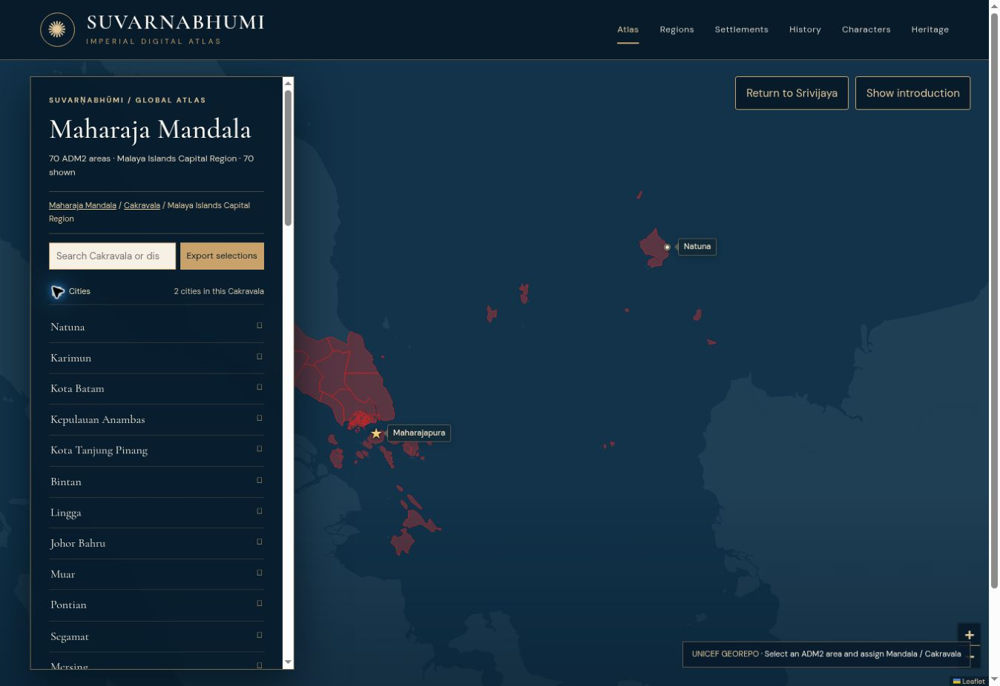

# Maharaja Mandala city layer

The city layer contains the 62 Suvarnabhumi city names and real-world location references supplied by the user. It uses static WGS84 coordinates bundled with the site; opening the map does not make a live geocoding request.

- [City data](../assets/map/cities/maharaja.json)
- [Reviewable location table (CSV)](../assets/map/cities/maharaja-locations.csv)
- [City layer implementation](../src/cities.js)

## Canon decisions

City names follow the user's supplied spelling. The explicit mapping takes precedence over older city entries elsewhere in the project: **Srivijaya is placed at Palembang**, following the user’s latest correction. **Dali is placed at Dali, Yunnan**; the original location string “Dalu” was corrected by the user before implementation. Guilin is intentionally placed at Qinzhou and Katagalan at Kaohsiung, following the supplied mappings rather than matching the Suvarnabhumi name to a modern city of the same name.

Maharajapura is marked as the imperial capital, at Batam. Other entries are marked as major cities. No population, city rank, or Cakravala-capital designation has been invented for this layer.

## Representative points and assumptions

These points locate cities; they do not define city or metropolitan boundaries.

| City | Supplied reference | Representative point |
|---|---|---|
| Kota Kapur | Kota Kapur, Bangka | Kotakapur village, Mendo Barat, Bangka; corrected by the user from the earlier Belitung reference |
| Natuna | Pulau Natuna | Ranai Kota; provisional urban anchor for the island |
| Pagaruyung | Pagaruyung | Istano Basa Pagaruyung landmark |
| Borobudur | Borobudur | Candi Borobudur landmark |
| Angkor | Angkor Wat | Angkor Wat landmark |
| Udamakatraya | Tarun (Talaud) | Tarun village on Karakelang, not a different Tarun |
| Hindiapura | Sri Vijaya Puram | GeoNames point under the former name Port Blair |

The other cities use the corresponding populated-place reference point. Ambiguous names were resolved by country and locality: for example, Ketapang in West Kalimantan, Banggai on Banggai Island, Bagan in the historic Pagan area, and Dali in Yunnan.

## Geographic affiliation

Cakravala and map ADM2 are derived from the repaired Cakravala/ADM2 layers. Sixty-one points are covered by their assigned map polygon. Naha uses the nearest map polygon (`Nahasi`, Liukyu Islands), approximately 0.00889 degrees from the reference point, because the simplified boundary does not cover the gazetteer point. Its point remains at the sourced coordinate; it was not moved to make it fit.

`locationMethod` and `distanceToBoundaryDegrees` preserve this distinction. The ADM2 field describes the atlas polygon matching the representative point; it is not an independent verification of a modern official municipal address. A city near a shoreline, lake, or administrative edge may need a more specific landmark reference later.

## Display behavior

- Cities are visible by default and can be toggled with **Cities**.
- All city points are available at Mandala and Cakravala overview levels.
- Opening one Cakravala filters the layer to its cities. The country browser filters by country.
- Maharajapura has a gold star. Other cities have small light markers with dark outlines.
- The imperial-capital label is eligible at all zoom levels. Other labels become eligible at zoom 5; labels yield to each other, the atlas panel, and viewport edges.
- Clicking a marker opens the city name, Mandala, Cakravala, and real-world reference.
- Labels and map filters update after zooming, panning, resizing, and navigation.

## Sources and attribution

Coordinate reference: [GeoNames](https://www.geonames.org/about.html), [CC BY 4.0](https://creativecommons.org/licenses/by/4.0/), downloaded 17 November 2026 from the `cities1000` extract and the Indonesia, Cambodia, and Myanmar country extracts. Each matching city record contains its GeoNames feature ID and source URL. Population values in GeoNames were used only to help disambiguate place searches and were not imported as fictional city populations.

Pagaruyung landmark coordinate: [Arsip Nasional Republik Indonesia, diplomatic letters location inventory](https://sejarah-nusantara.anri.go.id/media/userdefined/pdf/_report_locationdetails_sortnumletters_20141212.pdf), page 13: longitude 100.621335, latitude -0.471481.

The city's fictional name and modern location mapping come from the user. The coordinates and map affiliations are derived data and can be refined when the user supplies a landmark or a more precise point.

## Latest location corrections

The user subsequently corrected Srivijaya to Palembang and Kota Kapur to Kota Kapur on Bangka. Both coordinates are covered by their respective map ADM2 polygons (`Kota Palembang` and `Bangka`) within Srivijaya Special Administrative Region. The Return to Srivijaya shortcut targets the updated Palembang coordinate. The public browser checks documented above preceded this correction; the revised points were checked against the current geometry.

## Updating a location

Edit the city record in `assets/map/cities/maharaja.json` and keep `maharaja-locations.csv` synchronized. Preserve its stable `id`, user-supplied name, and location reference. If coordinates change, recalculate the map ADM2/Cakravala affiliation against the current repaired polygons and update the source/method fields. Validate unique IDs, finite WGS84 coordinates, and valid affiliation IDs before committing.

## Validation for the first release

The 62 unique entries were checked against the supplied references and current map membership IDs. Module-level checks cover initial marker counts, the imperial-capital marker, the Jambi reference for Srivijaya, Cakravala and country filters, the toggle, and cleanup when navigating away. These checks use lightweight map/DOM doubles. Syntax checks pass for both city and atlas modules. Public-site browser checks on 17 November 2026 verified all 62 marker buttons, the original Srivijaya popup (subsequently corrected from Jambi to Palembang), the Malaya Islands filter showing Maharajapura and Natuna, and the Cities toggle hiding and restoring the markers.

